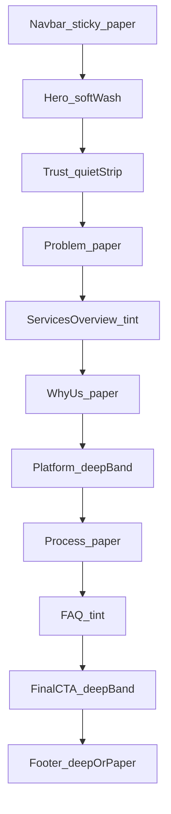

# Homepage Visual Design Plan

Visual treatment for the Torix homepage. Content structure is finalized and approved — this document covers **how it should look**, not what it contains. Do not change, reorder, add, or remove sections when implementing.

**Locked direction:** [docs/DESIGN_SYSTEM.md](DESIGN_SYSTEM.md) (Nocturne Light from [`referenceUI/Torix Site - Nocturne Light (standalone).html`](../referenceUI/Torix%20Site%20-%20Nocturne%20Light%20(standalone).html)). Do not invent a second palette or type stack.

**Approved section order (fixed):**

Navbar → Hero → Trust Bar → Problem Section → Services Overview → Why Choose Us → Healthcare Platform Spotlight → Our Process → FAQs → Final CTA Banner → Footer

There is deliberately **no Testimonials** section.

---

## 1. Visual Direction

### Tone

Premium, modern, clean, trustworthy, **technical healthcare** — confident product company, not a soft clinic brochure. Quiet surfaces, sharp outline icons, deep navy bands for emphasis. No stock hospital photography, no blue-cross clichés, no testimonials.

### Color palette (from design system)

| Role | Hex | Token |
|------|-----|-------|
| Page bg | `#f3f6fc` | `--color-bg` |
| Text | `#16182a` | `--color-text` |
| Accent (Primary Blue) | `#0a50d0` | `--color-accent` |
| Accent text/emphasis (Deep Blue) | `#0546c1` | `--color-accent-700` |
| Soft wash | `#eef4ff` / `#d6e6ff` | `--color-accent-100` / `--color-accent-200` |
| Bright highlight | `#207dff` | `--color-accent-500` |
| Paper | `#ffffff` | `--band-paper` |
| Tint band | `#e8f0fc` | `--band-tint` |
| Deep band | `#062a6e` → `#041a45` | `--band-deep` / `--band-deep-2` |
| Deep text | `#f4f6fe` / muted `rgba(244,246,254,0.72)` | `--band-deep-text` / `--band-deep-muted` |
| Muted copy | `#6a7288` | `--color-neutral-600` |
| Divider | text at 10% mix | `--color-divider` |

**Accent rule:** Accent is outline, border, icon, and kicker color — not large solid blue fills except primary CTAs. Depth comes from navy-blue bands + paper cards, not saturated blocks.

### Typography

- **Heading + body:** Inter (`--font-heading` / `--font-body`)
- **Heading weight:** 500; brand mark 600 / `-0.02em`
- **Hero H1:** `clamp(38px, 4.6vw, 62px)`, line-height `1.03`, short measure (~12ch)
- **Section H2:** `clamp(26px, 2.7vw, 34px)`; CTA titles may use `clamp(28px, 3.2vw, 40px)`
- **Lead:** 18px / line-height 1.6 / `#343744` (`--color-neutral-800`)
- **Body/UI:** 13–16px; kickers 11px uppercase / `0.08em` / accent-700
- **Process numbers:** `ui-monospace`, 12px, accent-700

### Global chrome

- Container `1280px`, side pad `clamp(24px, 4vw, 44px)`
- Radii 4 / 8 / 14 / pill 999
- Shadows = 1px ring + soft drop (`--shadow-sm` / `--shadow-md` / `--shadow-lg`)
- Primary CTA = outline accent button (hero size `15px` / `13px 24px`); secondary = paper + divider border; ghost = accent-700 text

### Page band rhythm

| Section | Band treatment |
|---------|----------------|
| Navbar | Sticky frosted paper |
| Hero | Soft wash gradient |
| Trust Bar | Quiet strip |
| Problem | Paper on page bg |
| Services Overview | Tint (with deep subsection for Solutions) |
| Why Choose Us | Paper |
| Platform Spotlight | Deep band |
| Our Process | Paper |
| FAQs | Tint |
| Final CTA | Deep band |
| Footer | Quiet deep or paper-with-divider |

---

## 2. Section-by-Section Visual Treatment

### Navbar

- **Layout:** Sticky top; logo left; links center/right; primary CTA right (“Book a Consultation”).
- **Weight:** Quiet chrome — frosted paper (`band-paper` 90% + `backdrop-filter: blur(12px)`), 1px divider bottom. Not a heavy colored bar.
- **Imagery:** None. Wordmark only.
- **Services/Solutions:** Dropdown labels keep the two groups separate (no mega-menu that merges them). Healthcare SEO stays out of nav.

### Hero

- **Layout:** 2-col grid `auto-fit minmax(340px, 1fr)`; copy left, supporting visual right; vertically centered.
- **Weight:** Highest on page. Soft wash background: `linear-gradient(170deg, var(--color-accent-200) 0%, var(--color-bg) 62%)`. Optional pill eyebrow above H1.
- **CTAs:** One primary outline (“Book a Consultation”); optional ghost secondary only if already in approved copy — do not invent.
- **Imagery:** Abstract UI / geometric product panel (card stack, soft hatch, outline icons) — **not** photo. Visual slot is structural, not decorative stock.

### Trust Bar

Labels: HIPAA Compliant / US-Based Team / In-Person Support / Software Builders.

- **Layout:** Full-width quiet strip under hero; single row of 4 items (icon + label), evenly spaced, centered in container.
- **Weight:** **Quiet** — paper or slight tint, thin top/bottom divider, no shadows, no cards. Labels 13–14px muted or neutral-700; icons 16–22px stroke accent.
- **Imagery:** Outline icons only; no photos, no numeric stats.

### Problem Section

3–4 icon + short-label pain points (denials, admin burden, lack of transparency, etc.).

- **Layout:** Section H2 + short support line; then 3–4 equal cards in `auto-fit minmax(240–280px, 1fr)`.
- **Weight:** Medium. Paper section on page bg; cards = bordered feature cards (`--color-bg` / paper, divider border, radius md, pad ~28px). Icon above short label (+ optional one-line mute).
- **Imagery:** One outline icon per pain point; no illustration scene.

### Services Overview

Two visually distinct card groups: **Services** and **Solutions**, each linking out. Shared section frame: H2 + one support line; then **two labeled groups stacked** (Services block, then Solutions block) — not one mixed grid.

| | **Services** (“we do this for you”) | **Solutions** (“we built this software”) |
|--|--------------------------------------|------------------------------------------|
| Section label | Kicker “Services” + light treatment | Kicker “Solutions” + deep/tech treatment |
| Card surface | Paper / light bordered cards on `--band-tint` group background | Deep cards **or** paper cards sitting on a deep band subsection |
| Accent | Accent outline icons, accent-300 borders | Icons in `--band-deep-text` / accent-300 on navy; optional wash only on light cards |
| Icon style | Stroke, accent-700 | Stroke, light-on-deep (or accent on paper if light cards) |
| CTA feel | Ghost / text link “Explore [service]” | Slightly stronger — secondary or ghost on deep: “Explore Solutions” / product links |

- **Weight:** High information, medium visual — groups separated by kicker + background shift, not by unrelated styles.
- **Imagery:** Icons + short labels only; no screenshots required on Home (platform gets its own spotlight next).

### Why Choose Us

2–3 differentiator blocks (in-person support, builds real healthcare software, US-based dedicated team).

- **Layout:** H2; 2–3 horizontal blocks (desktop: row or `minmax(280px, 1fr)` grid). Each block: icon + heading + short text.
- **Weight:** Medium-quiet. Paper band; prefer **open blocks** (icon + type) over heavy cards — or very light bordered cards if needed for tap targets. Differentiator is typography clarity, not ornament.
- **Imagery:** Outline icons only.

### Healthcare Platform Spotlight

Standalone but lightweight: 2–3 platform highlights + “Explore Healthcare Platform” link.

- **Layout:** Standalone deep band (`linear-gradient` deep → deep-2 or section → deep-2). Left: title + 2–3 highlight rows (icon + one line). Right or below: single text link/button “Explore Healthcare Platform”.
- **Weight:** **Lightweight but distinct** — one deep band so platform reads as tech without becoming a second hero. Max 2–3 highlights; no feature encyclopedia.
- **Imagery:** Optional small abstract UI motif (line frame); no marketing collage.

### Our Process

Numbered timeline: Consultation → Assessment → Onboarding → Ongoing Management → Reporting.

- **Layout:** H2; 5 equal step cards in a row (`minmax(190px, 1fr)`). Each: mono index `01`–`05`, title, one mute line.
- **Weight:** Medium. Paper section; step cards paper + radius md; numbers in accent-700 mono. Optional subtle connector line on desktop only if it stays quiet.
- **Imagery:** Numbers as the visual device — no photos.

### FAQs

Accordion, 4–6 questions.

- **Layout:** H2; single-column accordion (`details` / `summary`), max measure ~70ch, centered or left in container.
- **Weight:** **Low.** Tint or paper band; dividers only; no icons, no side art. Open state: slight accent border or text color on summary.
- **Imagery:** Explicitly none.

### Final CTA Banner

Reinforcing line + primary CTA.

- **Layout:** Deep band; reinforcing line (CTA-scale H2) + primary “Book a Consultation” centered (or left-aligned short measure).
- **Weight:** Strong close — same deep language as Platform spotlight so tech + trust bookend mid/low page; keep copy short.
- **Imagery:** None (or faint hatch only).

### Footer

- **Layout:** Multi-column sitemap (Services / Solutions / Company / Contact) + legal row; container-aligned.
- **Weight:** Quiet deep or paper-with-divider; 13px links; no large promo card.
- **Imagery:** None. No Healthcare SEO link.

---

## 3. Spacing and Rhythm

| Level | Use | Value |
|-------|-----|-------|
| Generous section pad | Between major sections | `clamp(56px, 6.5vw, 92px)` vertical |
| Hero pad | Top of page | `clamp(56px, 6.5vw, 96px)` |
| Medium gaps | Card grids, step rows | 16–24px; large grids `clamp(32–36px, 5vw, 64–72px)` |
| Tight | Icon-to-label, FAQ rows | 8–12px |

**Rule:** Prefer empty band over extra cards. Trust Bar and FAQ stay compressed; Hero / Services Overview / Final CTA get air. Do not adopt unused `--space-*` tokens as the live rhythm unless implementing tokens later — use the clamp/px values above (per design system).

---

## 4. Mobile Behavior Notes

| Section | Beyond “stack” |
|---------|----------------|
| Navbar | Collapse to logo + CTA + menu button; dropdowns become accordion panels; sticky retained |
| Hero | Visual **below** copy; reduce H1 measure; CTA full-width optional |
| Trust Bar | Wrap to **2×2** grid; keep equal columns; no horizontal scroll |
| Problem | 1-col cards, full width |
| Services Overview | Services group stacks, then Solutions group; group kickers stay visible as separators |
| Why Choose Us | Single column; icon left or top, consistent |
| Platform Spotlight | Highlights stack; CTA full-width under list |
| Process | **Vertical timeline**: number left, content right; cards full width; drop horizontal connectors |
| FAQ | Full-bleed within side padding; large tap area on summary |
| Final CTA | Centered stack; button full-width |
| Footer | Single column link lists |

Breakpoints follow auto-fit grids from the design system (~340px hero columns, ~190–280px cards) — no separate desktop-only layouts.

---

## 5. Explicit Non-Goals

- No Testimonials / logos-as-proof / invented stats
- No stock clinical photography anywhere on Home
- No merging Services and Solutions into one undifferentiated card grid
- No Healthcare SEO in nav/footer
